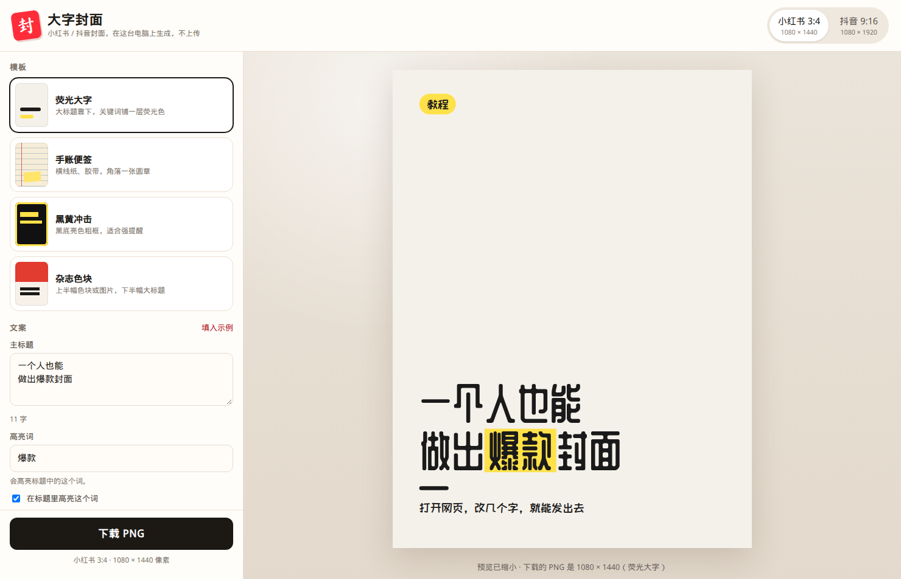
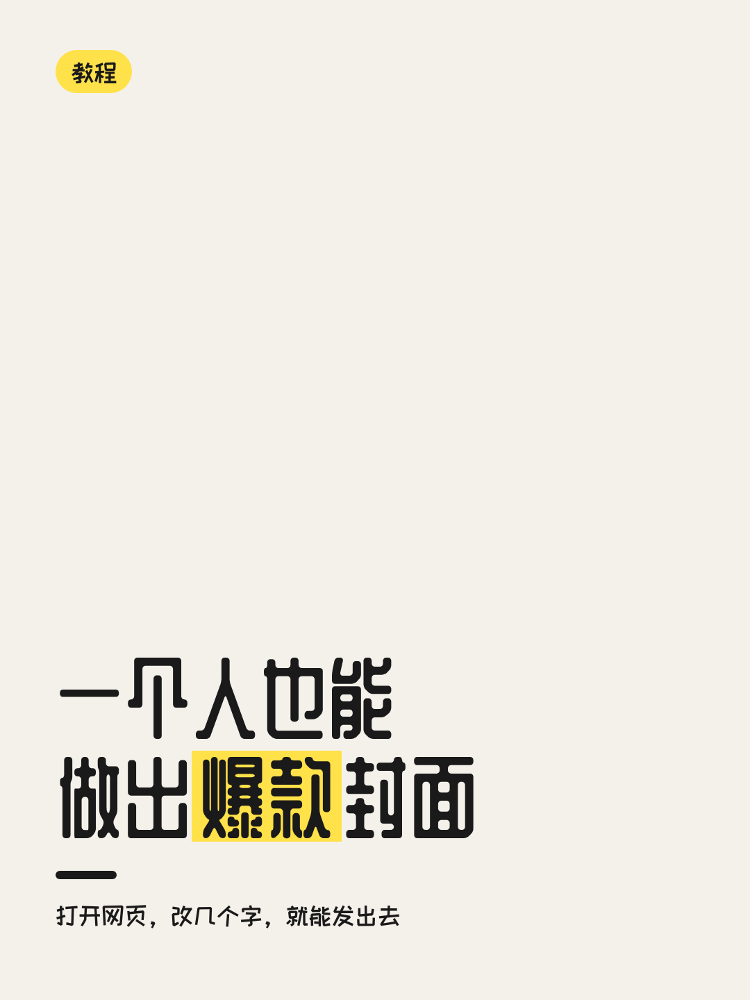
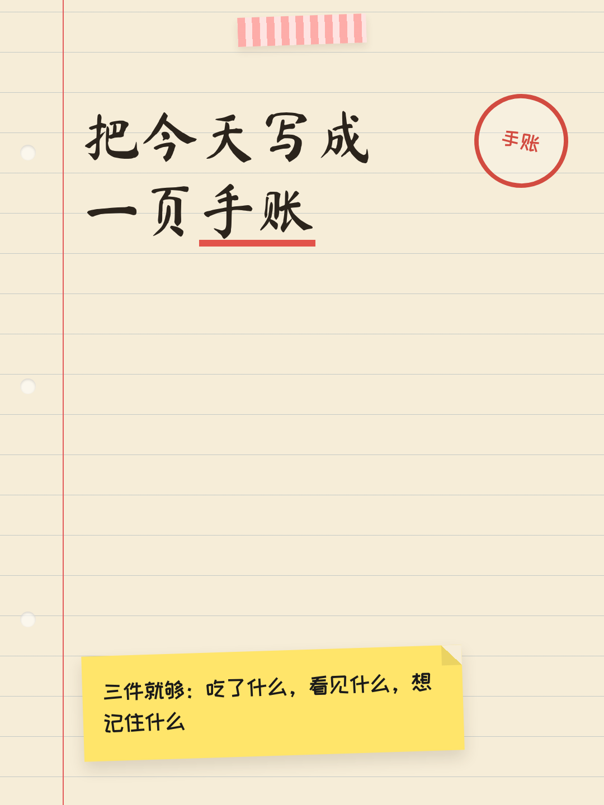
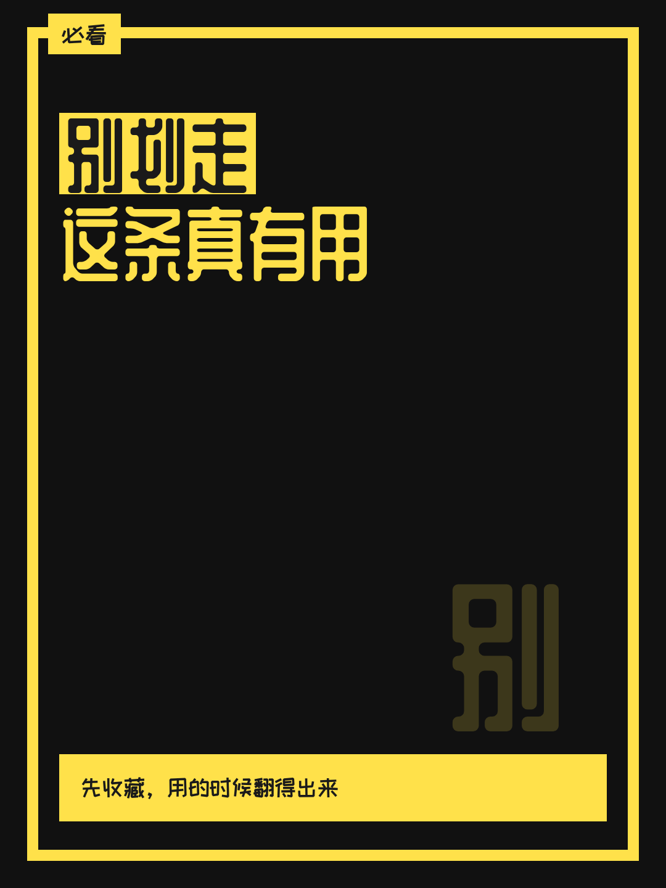
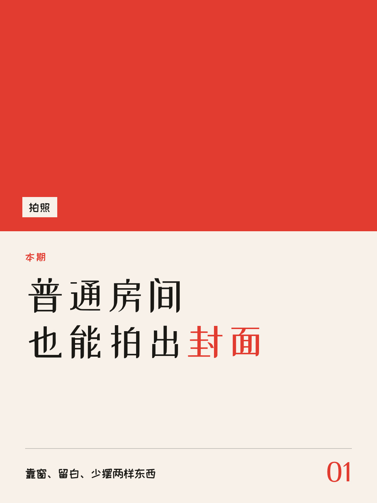
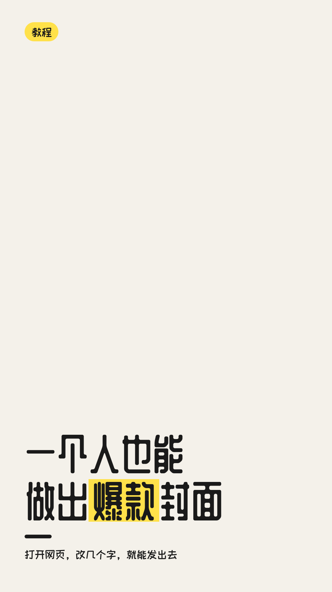
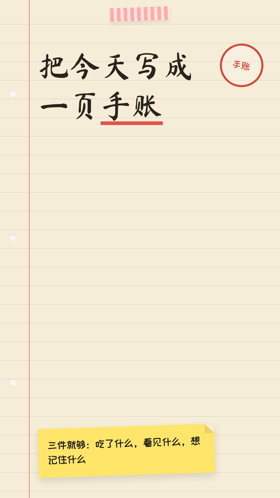
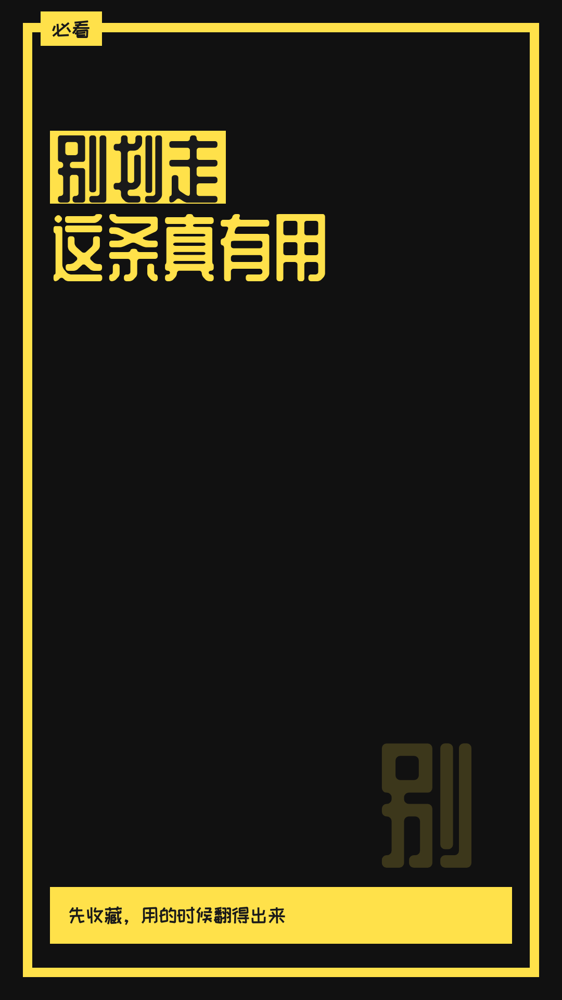
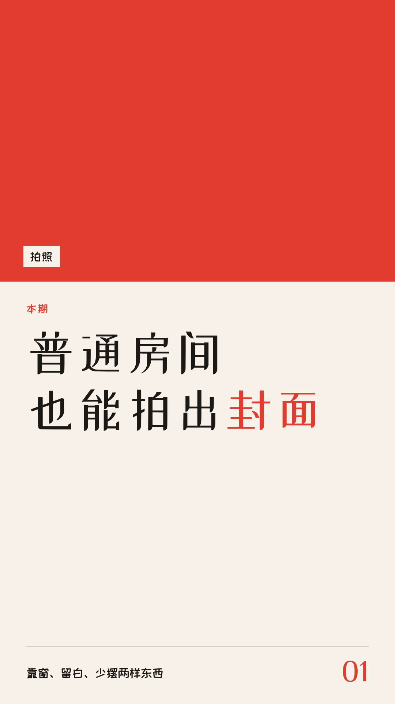
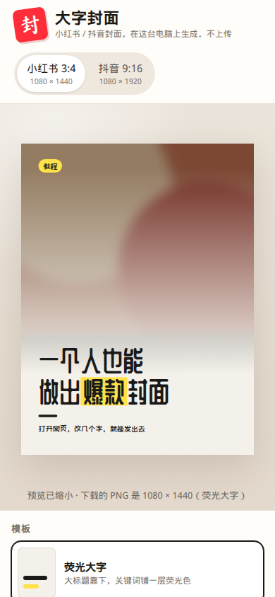

# 大字封面

在线演示：https://aarowv.github.io/Dy-xhs-cover/

在浏览器里做小红书和抖音的大字封面。选一个模板，改标题、副标题和角标，调颜色，也可以放自己的图，然后下载 PNG。

全部在你自己的电脑上完成：不登录、不上传、没有服务器。



## 两种尺寸

| 平台 | 比例 | 导出像素 |
| --- | --- | --- |
| 小红书 | 3:4 | 1080 × 1440 |
| 抖音 | 9:16 | 1080 × 1920 |

预览会缩小显示。点「下载 PNG」得到的是上面的原尺寸。

## 四套模板

小红书 3:4：

<p>
  
  
  
  
</p>

抖音 9:16：

<p>
  
  
  
  
</p>

手机上预览在上面，模板和文案在下面。背景图可以拖进预览，字会压在渐变上，方便阅读：

<p>
  
  
</p>

## 在线用

演示站：https://aarowv.github.io/Dy-xhs-cover/

推送到 GitHub 仓库 `AarowV/Dy-xhs-cover` 的 `main` 分支后，`.github/workflows/pages.yml` 会把整个静态站点发布到 GitHub Pages。页面挂在 `/Dy-xhs-cover/` 下面，样式和脚本用的是相对路径，并在 `index.html` 里按当前目录设置了 `<base>`，所以子路径下也能加载。

第一次发布前，到仓库的 Settings → Pages，把 Build and deployment 的 Source 选成 **GitHub Actions**（不要选 Deploy from a branch）。选好之后，每次推 `main` 都会自动部署。

页面根目录有一个空的 `.nojekyll`。用 Actions 发布时不会走 Jekyll，留着它只是避免以后改回「从分支发布」时漏文件。

## 在自己电脑上用

不需要安装依赖，也不用构建。

- 直接双击 `index.html`，用 Chrome 或 Edge 打开。
- 或者在项目目录里运行：

```bash
python3 -m http.server 8741
```

然后打开 `http://127.0.0.1:8741`。

用法：

1. 选模板：荧光大字、手账便签、黑黄冲击、杂志色块。
2. 选尺寸：小红书 3:4 或抖音 9:16。
3. 写主标题。要高亮某个词，可以在「高亮词」里填，也可以在标题里写成 `做出【爆款】封面`。括号不会出现在封面上。
4. 副标题和角标可以空着。
5. 改背景色、文字色、强调色，或点预设。
6. 可选：上传一张 JPG / PNG，或把它拖到右侧预览上。拖动「图片变暗」让字更清楚。
7. 点「下载 PNG」。文件名类似 `封面-荧光大字-1080x1440.png`。

字太多时会自动缩小，免得超出画面。换模板时，如果你还没改过示例文案，会换成那套模板自己的例句；已经改过的句子会留下。

## 怎么加一个模板

模板清单在 `js/templates.js`，样子在 `css/templates.css`。左侧列表是根据清单自动画出来的，所以不用改 HTML。

1. 在 `TEMPLATES` 数组里复制一份对象。
2. 改 `id`（英文，不要空格）、`name`、`desc`、`defaults`（默认标题和三个颜色）。
3. 在 `render(d)` 里写这个模板的 HTML。标题用 `d.titleHtml`，副标题用 `d.subtitleHtml`，角标用 `d.tagHtml`。这些已经转义过，不要把用户原文直接拼进去。
4. 给标题加上 `data-bind="title"` 和 `data-fit data-fit-max="140" data-fit-min="56"`。副标题用 `data-bind="subtitle"`，角标用 `data-bind="tag"`。`data-fit` 会在字装不下时缩小字号，元素自己要在 CSS 里写 `max-height` 和 `overflow: hidden`。
5. 在 `css/templates.css` 里加 `.tpl-你的id`。画布上还会有 `size-xhs` 或 `size-dy`。颜色用变量：`--bg`、`--fg`、`--accent`、`--on-accent`。
6. 刷新浏览器。

文件底部有一段注释掉的「纯色居中」例子，取消注释就能看到一个最简单的模板。

想看 1:1 大图，可以打开 `index.html?tpl=你的id&size=dy&view=board`。

画布宽度固定 1080。不要在模板根元素上再写 `height`，否则会把 1440 / 1920 盖掉。

## 字体

标题和正文用的是可免费商用的字体，嵌在 `js/fonts.js` 里，断网也能显示：

| 字体 | 用在 | 许可 |
| --- | --- | --- |
| 站酷庆科黄油体 | 荧光大字、黑黄冲击的标题 | SIL OFL 1.1 |
| 马善政毛笔楷书 | 手账标题 | SIL OFL 1.1 |
| 站酷小薇 | 杂志标题 | SIL OFL 1.1 |
| 站酷快乐体 | 副标题、角标 | SIL OFL 1.1 |

授权全文在 `fonts/OFL-*.txt`。界面其余文字用系统里的中文字体（苹方、微软雅黑等）。

## 许可

本项目代码以 [MIT 许可](LICENSE) 发布。字体仍使用各自的 SIL OFL，不受 MIT 替代。
